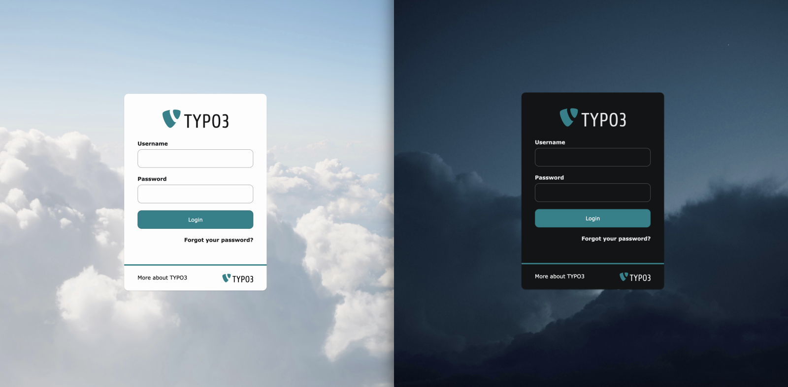

# Login Color Scheme

[](https://get.typo3.org/version/13)
[](https://get.typo3.org/version/14)
[](LICENSE.md)

The TYPO3 backend login screen follows the visitor's preferred color scheme, but the core
setting `[BE][loginBackgroundImage]` accepts only one image. This extension adds a second
setting for the image to use while the dark color scheme is active.



Related: [forge issue #106760](https://forge.typo3.org/issues/106760).

## Requirements

| TYPO3        | PHP  |
|--------------|------|
| 13.4 LTS     | ≥ 8.2 |
| 14.x         | ≥ 8.3 |

## Installation

```bash
composer require maikschneider/login-color-scheme
```

## Configuration

The extension adds a single setting, `backgroundImageDark`. Set it in
*Admin Tools → Settings → Extension Configuration → login_color_scheme*, or in
`config/system/settings.php`:

```php
'EXTENSIONS' => [
    'backend' => [
        // light color scheme, handled by TYPO3 core
        'loginBackgroundImage' => 'EXT:my_sitepackage/Resources/Public/Images/login.jpg',
    ],
    'login_color_scheme' => [
        // dark color scheme, handled by this extension
        'backgroundImageDark' => 'EXT:my_sitepackage/Resources/Public/Images/login-dark.jpg',
    ],
],
```

The value accepts the same formats as the core setting: an `EXT:` path, a path relative to
the project root such as `fileadmin/login-dark.jpg`, or an absolute URL.

Configuring only the dark image is valid. Light mode then falls back to the plain
background color, as it does in an unconfigured TYPO3.

## How it works

A backend middleware adds one inline CSS block to every route that renders the login
layout — login, login refresh, password reset and MFA:

```css
@media (prefers-color-scheme: dark) {
    :root:not([data-color-scheme="light"]) .typo3-login { background-image: url("…"); }
}
:root[data-color-scheme="dark"] .typo3-login { background-image: url("…"); }
```

Two rules are needed because the backend has three color scheme states. The authentication
screens carry no `data-color-scheme` attribute and therefore follow the operating system,
while a logged-in user reaching the login refresh dialog may have pinned light or dark in
their user settings.

The selectors are more specific than the core `.typo3-login` rule, so the override applies
regardless of render order. The URL is escaped with
`GeneralUtility::sanitizeCssVariableValue()`, the same helper core uses, and the block is
emitted with a CSP nonce.

## Limitations

The extension covers the background image only. The login logo (`loginLogo`) and the
highlight color (`loginHighlightColor`) are not color scheme aware either, but the logo is
inlined by a ViewHelper and needs a different approach — see
[forge issue #107558](https://forge.typo3.org/issues/107558).

## Development

```bash
composer install
composer sca      # composer normalize, editorconfig, php lint, php-cs-fixer, phpstan, xliff
composer tests    # unit tests
```

Bug reports and pull requests are welcome, see [CONTRIBUTING.md](CONTRIBUTING.md).

## License

GPL-2.0-or-later
